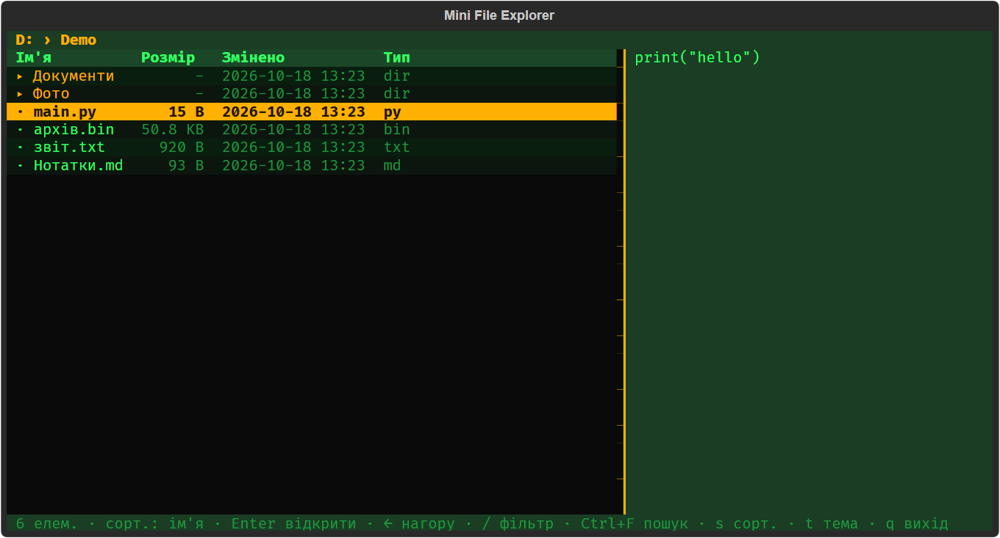
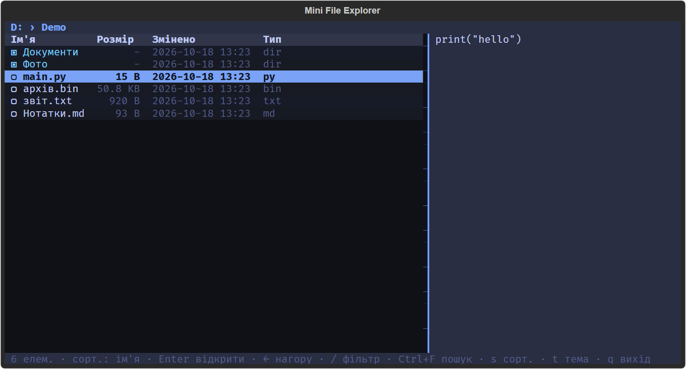

# Mini File Explorer

Клавіатурний файловий провідник для терміналу на **Python + [Textual](https://textual.textualize.io/)**.
Лабораторна №11 — рівень **Standard** з власною темою оформлення (retro / modern).





## Що зроблено

**Рівень: Standard** (Basic + Standard повністю).

| Вимога | Реалізація |
|---|---|
| Список файлів і папок, візуально розрізняються | Іконки та кольори, папки завжди зверху |
| Вхід у папку / до батьківської, поточний шлях | `Enter`, `→` / `←`, `Backspace`; breadcrumb угорі |
| Помилки шляхів і прав доступу | Статус-бар, програма не падає і лишається на місці |
| Розмір, дата зміни, тип | Колонки таблиці, розмір у `KB/MB/GB` |
| Сортування | `s` — ім'я → розмір → дата |
| Живий фільтр за назвою | `/` — список оновлюється під час набору |
| Рекурсивний пошук | `Ctrl+F`, обхід у ширину через чергу, у фоновому потоці |
| Прев'ю текстових файлів | Права панель: перші 8 КБ / 60 рядків, бінарні файли розпізнаються |
| Надійність | Биті symlink, цикли symlink, видалена поточна папка, не-ASCII імена |

**Side quests:** не робилися (за вибором — лише Standard).

## Персональна «родзинка» — стильна тема

Два повноцінних оформлення, що перемикаються на льоту клавішею `t` (або `--theme` при запуску):

- **retro** — бурштин і люмінесцентний зелений на чорному, як у старих терміналах;
- **modern** — темна палітра з холодним синім акцентом.

*Чому саме так:* файловий менеджер користувач бачить щодня, тож читабельність і настрій інтерфейсу — частина зручності.
Теми підключені через механізм тем Textual (`Theme.to_textual()`), тому кольори керують усіма віджетами через CSS-змінні, а не розкидані по коду.

## Запуск

```bash
python -m venv .venv
.venv\Scripts\activate          # Linux/macOS: source .venv/bin/activate
pip install -e .
python -m explorer              # поточна папка
python -m explorer D:\Photos    # конкретна папка
python -m explorer --theme modern
```

Потрібен Python 3.11+. Після `pip install -e .` також працює команда `explorer`.

### Готовий `.exe` (Windows)

```bash
pip install pyinstaller
python -m PyInstaller --onefile --console --name MiniFileExplorer --paths src --collect-data textual packaging/launcher.py
```

Результат — `dist\MiniFileExplorer.exe`. Запускати його треба з Windows Terminal або `cmd`/PowerShell
(це консольний застосунок, подвійний клік відкриє власне вікно консолі): `MiniFileExplorer.exe D:\Photos --theme modern`.

### Топ-5 клавіш

| Клавіша | Дія |
|---|---|
| `↑` / `↓` | вибір елемента |
| `Enter` / `→` | відкрити папку |
| `←` / `Backspace` | на рівень вгору |
| `/` | живий фільтр, `Ctrl+F` — рекурсивний пошук |
| `t` | змінити тему |

### Усі клавіші

| Клавіша | Дія |
|---|---|
| `↑` `↓` | вибір |
| `Enter`, `→` | відкрити папку (у результатах пошуку — перейти до файлу) |
| `←`, `Backspace` | нагору; під час фільтра/пошуку — вийти з нього |
| `s` | змінити сортування (ім'я → розмір → дата) |
| `/` | фільтр за назвою (`Enter` — зафіксувати, `Esc` — скинути) |
| `Ctrl+F` | рекурсивний пошук від поточної папки (`Enter` — запустити) |
| `Esc` | скасувати пошук / скинути фільтр |
| `t` | перемкнути тему retro ↔ modern |
| `r` | оновити список |
| `q` | вийти |

## Як програма обходить дерево

- **Показ папки** (`fs.list_dir`): один виклик `os.scandir`, для кожного запису окремо читаються метадані. Функція завжди повертає `(записи, повідомлення_про_помилку)` і **ніколи не кидає виняток** — інтерфейс просто показує помилку.
- **Рекурсивний пошук** (`search.search`) використовує **чергу** (`collections.deque`), а не рекурсію: це обхід у ширину. Через це глибина дерева не обмежена лімітом рекурсії Python (~1000 рівнів), а найближчі результати знаходяться першими.
- **Цикли symlink:** для кожної папки рахується `os.path.realpath`, і вже відвідані реальні папки пропускаються. Пошук також має ліміт результатів (500) і працює у фоновому потоці, тому його можна скасувати `Esc`.
- Усі шляхи будуються через `pathlib`, без склеювання рядків; текст читається як UTF-8.

## Обробка помилок доступу

Кожен виклик файлової системи обгорнутий у `try/except OSError`:

| Ситуація | Що відбувається |
|---|---|
| `PermissionError` на папці | Статус-бар: «Немає доступу до цієї папки», лишаємося в поточній папці |
| Шлях не існує / не папка | Відповідне повідомлення, програма не падає |
| Недоступний файл у прев'ю | У панелі прев'ю — пояснення замість вмісту |
| Недоступна папка під час пошуку | Пропускається; у статусі — «недоступних папок: N» |
| Битий symlink | Показується з позначкою червоним, `stat` не падає |
| Поточну папку видалено | `r` піднімає до найближчого існуючого батька і повідомляє про це |

## Відповіді на питання для захисту

- **Що буде, якщо поточну папку видалили?** `list_dir` поверне помилку, а `r` викличе `nearest_existing` — підйом до найближчого існуючого батька зі статус-повідомленням.
- **А якщо в імені файлу є новий рядок?** Імена виводяться через `printable_name`: керуючі символи замінюються на `⏎`/`�`, тож таблиця не ламається.
- **Рекурсія чи черга?** Рекурсія обмежена стеком Python і найгірше поводиться саме на глибоких деревах; черга (BFS) не має такого ліміту, а явна множина відвіданих папок усуває нескінченні цикли.
- **Найскладніший баг.** Атрибут `visible` в `App` конфліктує з властивістю `DOMNode.visible` у Textual (падіння `unhashable type: 'list'`), тому список відображених записів називається `shown`.

## Структура проєкту

```
src/explorer/
  fs.py        читання каталогів, Entry, human_size, nearest_existing
  sorting.py   сортування й фільтр
  search.py    рекурсивний пошук через чергу
  preview.py   прев'ю текстових файлів
  themes.py    теми retro / modern
  app.py       інтерфейс Textual
  __main__.py  CLI
tests/         pytest: fs, sorting, search, preview, themes, UI
docs/          скріншоти
```

## Тести

```bash
pip install -e .[dev]
pytest
```

Тести, що потребують symlink або символу нового рядка в імені, автоматично пропускаються там, де ОС цього не дозволяє (наприклад, Windows без прав на symlink).


